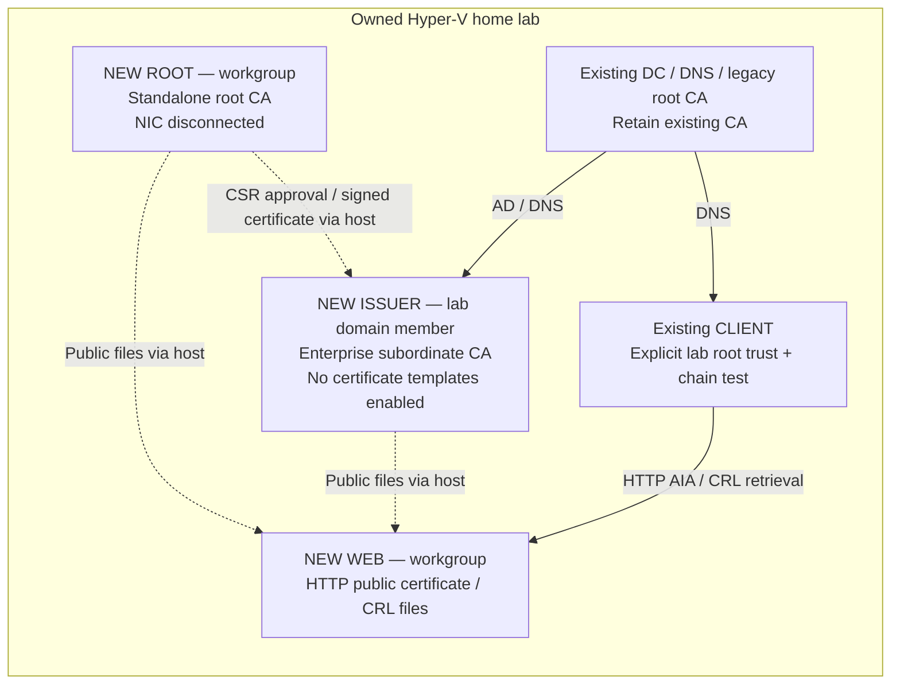

# Day 14 — Establish the home-lab certificate authority

Prepared September 29, 2026 • Hyper-V / Windows Server 2022 • Follow in order, one block at a time.

## Today's outcome

Build a **new offline standalone root CA → new enterprise issuing CA**, publish their public certificates and revocation lists, and verify the issuing certificate's chain. Leave the existing CA on your lab domain controller intact. Server-certificate templates and HTTPS enrollment are Days 15–16.

Your Day 13 inventory is finished. Its saved result still lists ROOT, ISSUER and WEB as **planned**, and records unsynchronized clocks on the DC/client. This runbook carries those prerequisites forward; it does not assume three installed servers. No Whizlabs subscription or Terraform deployment is needed.

**Time:** allow roughly 3–4 hours from blank VMs; Windows installation and troubleshooting determine the actual duration. With installed clean guests, the PKI portion is shorter. This is not a two-hour sandbox deadline. Useful pause points:

- After Phase 3: operating systems, network and time checked.
- After Phase 4: root established; the two-tier hierarchy is still **PARTIAL**.
- After Phase 8: working hierarchy and validation proof; finish Phase 9 before closing.

**Recovery choice:** these are disposable learning systems. Retain their VM disks and configuration; rebuild if lost. No backup product or restore test is required to begin. A CA rebuild produces a new identity: certificates issued by the lost CA do not become valid under its replacement. Do not roll back a CA checkpoint after issuing certificates. An optional password-protected native CA backup appears at the end.

### Topology / what changes today



This is a **target diagram**, not deployment evidence. WEB does not need domain membership to serve public files, so it stays in a workgroup. Enterprise CA installation registers the new issuer in the owned lab forest; there is no new root-trust GPO. Explicit root imports below target only ISSUER and CLIENT. The Hyper-V host remains privileged enough to access the offline VM; a disconnected NIC is network isolation, not protection from a compromised host.

### How to follow the commands

Use **elevated Windows PowerShell 5.1 on the Hyper-V host**, unless a step explicitly says VMConnect. Keep that host console open. `Invoke-Command -Session $RootSession { ... }` runs the enclosed commands inside ROOT; `$using:Name` passes a host variable into that guest. `Copy-Item -ToSession/-FromSession` transfers files without SMB or a connected guest NIC. Password prompts stay in memory; never paste passwords into these blocks. [PowerShell Direct](https://learn.microsoft.com/en-us/windows-server/virtualization/hyper-v/powershell-direct).

These blocks are **not an idempotent script**. On an error, stop at that block, retain its output privately, and inspect the recorded objects. Do not rerun all creates, generate another CA key, or use overwrite switches to get past a collision. After closing the console, restore context as shown in Phase 9 and reconnect sessions; do not restart at Phase 1.

## 1. Record exact targets before creating anything

**Purpose:** select the owned isolated lab, unused names/IPs, ISO and disk location. Run on the Hyper-V host. The proposed CA display names below follow Day 13; change them now if desired, never casually after installation.

```powershell
$ErrorActionPreference = 'Stop'
Import-Module Hyper-V
Get-VM | Select-Object Name, Id, State
Get-VMSwitch | Select-Object Name, SwitchType
Get-Volume | Select-Object DriveLetter, SizeRemaining

$LabSwitch = Read-Host 'Exact existing isolated Internal switch name'
$Switch = Get-VMSwitch -Name $LabSwitch
if ($Switch.SwitchType -ne 'Internal') { throw 'Expected the inventoried Internal lab switch.' }
$Iso = Read-Host 'Full path to your Windows Server 2022 ISO'
if (-not (Test-Path -LiteralPath $Iso -PathType Leaf)) { throw 'ISO not found.' }
$VmBase = Read-Host 'Existing dedicated folder for these new VM folders, outside Git'
if (-not (Test-Path -LiteralPath $VmBase -PathType Container)) { throw 'Choose an existing storage folder.' }
$RootVM = Read-Host 'NEW ROOT VM/computer name, e.g. PKIROOT01'
$IssuerVM = Read-Host 'NEW ISSUER VM/computer name, e.g. PKIISSUE01'
$WebVM = Read-Host 'NEW WEB VM/computer name, e.g. PKIWEB01'
$DcVM = Read-Host 'Existing lab DC VM name from Day 13'
$ClientVM = Read-Host 'Existing lab CLIENT VM name from Day 13'
$LabDomain = Read-Host 'Existing lab DNS domain'
$DcIP = Read-Host 'Existing lab DC/DNS IPv4 address'
$IssuerIP = Read-Host 'Reserved UNUSED IPv4 for ISSUER on this lab subnet'
$WebIP = Read-Host 'Reserved UNUSED IPv4 for WEB on this lab subnet'
$Prefix = [int](Read-Host 'Lab subnet prefix length, e.g. 24')
$PkiLabel = Read-Host 'Unused DNS label for public files, e.g. pki'
$PkiFqdn = "$PkiLabel.$LabDomain"
$RootCA = 'Mark Lab Root CA'
$IssuerCA = 'Mark Lab Issuing CA'
$Names = @($RootVM, $IssuerVM, $WebVM)
if (($Names | Select-Object -Unique).Count -ne 3) { throw 'Three distinct new names required.' }
foreach ($Name in $Names) {
    if ($Name -notmatch '^[A-Za-z][A-Za-z0-9-]{0,13}[A-Za-z0-9]$') { throw 'Use 2-15 characters: letters, digits, internal hyphens.' }
    if (@(Get-VM | Where-Object Name -eq $Name).Count) { throw "VM already exists: $Name. Inspect; do not adopt automatically." }
    if (Test-Path -LiteralPath (Join-Path $VmBase $Name)) { throw "Storage path already exists for $Name." }
}
if ($PkiLabel -notmatch '^[a-zA-Z][a-zA-Z0-9-]*$') { throw 'Use a single simple DNS label.' }
if ($Prefix -lt 1 -or $Prefix -gt 30) { throw 'Check the lab subnet prefix.' }
foreach ($Address in @($DcIP, $IssuerIP, $WebIP)) {
    if ([ipaddress]::Parse($Address).AddressFamily -ne 'InterNetwork') { throw 'IPv4 required.' }
}
if ((@($DcIP, $IssuerIP, $WebIP) | Select-Object -Unique).Count -ne 3) { throw 'Addresses must differ.' }
# Confirm against the Day 13 inventory/DHCP allocations. A failed ping does NOT prove an IP is unused.
if ((Read-Host 'Names/IPs unused, same subnet, isolated lab confirmed? Type VERIFIED') -cne 'VERIFIED') { throw 'Resolve inventory first.' }

$Evidence = Join-Path $env:LOCALAPPDATA ('CloudSecurityLab\day14-' + (Get-Date -Format yyyyMMdd-HHmmss))
New-Item -ItemType Directory -Path $Evidence | Out-Null
$Context = [pscustomobject]@{
    HostName=$env:COMPUTERNAME; LabSwitch=$LabSwitch; Iso=$Iso; VmBase=$VmBase
    RootVM=$RootVM; IssuerVM=$IssuerVM; WebVM=$WebVM; DcVM=$DcVM; ClientVM=$ClientVM
    LabDomain=$LabDomain; DcIP=$DcIP; IssuerIP=$IssuerIP; WebIP=$WebIP; Prefix=$Prefix
    PkiLabel=$PkiLabel; PkiFqdn=$PkiFqdn; RootCA=$RootCA; IssuerCA=$IssuerCA; Evidence=$Evidence
}
$Context | Export-Clixml -LiteralPath (Join-Path $Evidence 'context.xml')
$Names | ForEach-Object {
    [pscustomobject]@{Name=$_; Folder=(Join-Path $VmBase $_); Purpose='Day14 dedicated new PKI guest'}
} | Export-Csv -LiteralPath (Join-Path $Evidence 'vm-create-intent.csv') -NoTypeInformation
$Evidence
```

**Success:** private context and create-intent files exist; names/IPs selected from inventory. **Stop:** collision, uncertain network boundary, insufficient disk/RAM or wrong host. **Recovery:** no infrastructure change yet. Evidence lives outside Git and must stay private.

## 2. Create three clean guests and install Windows

**Purpose:** build separate CA/public-file machines without repurposing the DC or old hacking VMs. Budget 4 GB RAM, two virtual CPUs and a 64 GB dynamically expanding disk per VM. Verify current free capacity first. [Hyper-V VM creation](https://learn.microsoft.com/en-us/windows-server/virtualization/hyper-v/get-started/create-a-virtual-machine-in-hyper-v).

```powershell
foreach ($Name in $Names) {
    $Folder = Join-Path $VmBase $Name
    $VM = New-VM -Name $Name -Generation 2 -MemoryStartupBytes 4GB -Path $Folder `
        -NewVHDPath (Join-Path $Folder "$Name.vhdx") -NewVHDSizeBytes 64GB
    $VM | Select-Object Name, Id, Path | Export-Clixml -LiteralPath (Join-Path $Evidence "$Name-vm.xml")
    Set-VM -VM $VM -ProcessorCount 2 -AutomaticCheckpointsEnabled $false `
        -AutomaticStartAction Nothing -AutomaticStopAction ShutDown
    if ($Name -ne $RootVM) {
        Get-VMNetworkAdapter -VM $VM | Connect-VMNetworkAdapter -SwitchName $LabSwitch
    }
    $DVD = Add-VMDvdDrive -VM $VM -Path $Iso -Passthru
    Set-VMFirmware -VM $VM -EnableSecureBoot On -SecureBootTemplate MicrosoftWindows -FirstBootDevice $DVD
    Start-VM -VM $VM
}
Get-VM -Name $Names | Select-Object Name, Id, State
Get-VMNetworkAdapter -VMName $RootVM | Select-Object VMName, SwitchName
vmconnect.exe localhost $RootVM
```

In VMConnect, press a key promptly to boot the DVD. If you miss the prompt, use the console's restart command and try again **only on that new blank guest**. Install **Windows Server 2022 Standard Evaluation (Desktop Experience)**, Custom installation, onto its sole new blank disk. Set a local Administrator password and sign in once. Repeat for ISSUER and WEB:

```powershell
vmconnect.exe localhost $IssuerVM
vmconnect.exe localhost $WebVM
```

Windows Setup is an intentional interactive step; this loop creates VM hardware, not an unattended Windows installation. Do not clone a domain controller or a non-generalized Windows disk to save time. If Enhanced Session rejects login, switch VMConnect to **Basic Session**; do not grant extra RDP privileges to solve a console problem.

After all three installations, run:

```powershell
$RootCred = Get-Credential -Message 'ROOT guest LOCAL Administrator'
$IssuerLocalCred = Get-Credential -Message 'ISSUER guest LOCAL Administrator'
$WebCred = Get-Credential -Message 'WEB guest LOCAL Administrator'
$RootSession = New-PSSession -VMName $RootVM -Credential $RootCred
$IssuerSession = New-PSSession -VMName $IssuerVM -Credential $IssuerLocalCred
$WebSession = New-PSSession -VMName $WebVM -Credential $WebCred
$Pairs = @(@($RootSession,$RootVM), @($IssuerSession,$IssuerVM), @($WebSession,$WebVM))
foreach ($Pair in $Pairs) {
    Invoke-Command -Session $Pair[0] -ArgumentList $Pair[1] -ScriptBlock {
        param($NewName)
        $ErrorActionPreference = 'Stop'
        $CS = Get-CimInstance Win32_ComputerSystem
        if ($CS.PartOfDomain -or $CS.DomainRole -ge 4) { throw 'Expected a fresh workgroup guest.' }
        if (Test-Path 'HKLM:\SYSTEM\CurrentControlSet\Services\CertSvc\Configuration') { throw 'Existing CA configuration found.' }
        New-Item -ItemType Directory -Path 'C:\LabPKI' | Out-Null
        Rename-Computer -NewName $NewName
        shutdown.exe /r /t 10
        if ($LASTEXITCODE -ne 0) { throw 'Guest restart scheduling failed.' }
    }
}
Remove-PSSession $RootSession, $IssuerSession, $WebSession
```

Wait until each renamed guest has restarted and you can sign in. Reconnect:

```powershell
$RootSession = New-PSSession -VMName $RootVM -Credential $RootCred
$IssuerSession = New-PSSession -VMName $IssuerVM -Credential $IssuerLocalCred
$WebSession = New-PSSession -VMName $WebVM -Credential $WebCred
foreach ($Name in $Names) { Get-VMDvdDrive -VMName $Name | Set-VMDvdDrive -Path $null }
```

**Success:** three correctly named, fresh Server guests; ROOT NIC has no switch. **Stop:** existing role/domain, install failure, wrong disk or identity. **Recovery:** retain exact recorded VM IDs. Pre-CA guests can be rebuilt individually; do not delete or checkpoint the existing DC. No CA key has been created yet.

## 3. Set the new network, join ISSUER, and check actual time

**Purpose:** give WEB/ISSUER stable addresses, verify the lab directory and inspect the Day 13 time warning. ROOT requires no network address.

```powershell
foreach ($Pair in @(@($IssuerSession,$IssuerIP), @($WebSession,$WebIP))) {
    Invoke-Command -Session $Pair[0] -ArgumentList $Pair[1],$Prefix,$DcIP -ScriptBlock {
        param($IP,$PrefixLength,$DnsIP)
        $ErrorActionPreference = 'Stop'
        $Nic = @(Get-NetAdapter | Where-Object Status -eq Up)
        if ($Nic.Count -ne 1) { throw 'Expected exactly one active lab NIC.' }
        Get-NetIPConfiguration | Format-List * | Out-File 'C:\LabPKI\network-before.txt'
        if (@(Get-NetIPAddress -InterfaceIndex $Nic[0].ifIndex -AddressFamily IPv4 |
            Where-Object { $_.PrefixOrigin -eq 'Manual' -and $_.IPAddress -notlike '169.254.*' }).Count) {
            throw 'Manual address already present; inspect before changing.'
        }
        New-NetIPAddress -InterfaceIndex $Nic[0].ifIndex -IPAddress $IP -PrefixLength $PrefixLength
        Set-DnsClientServerAddress -InterfaceIndex $Nic[0].ifIndex -ServerAddresses $DnsIP
        Get-NetIPAddress -InterfaceIndex $Nic[0].ifIndex -AddressFamily IPv4
    }
}
# No default gateway is added to this isolated subnet.
$LabAdmin = Get-Credential -Message 'Existing owned LAB forest administrator (not an employer account)'
$DcSession = New-PSSession -VMName $DcVM -Credential $LabAdmin
$ClientCred = Get-Credential -Message 'Existing LAB CLIENT administrator'
$ClientSession = New-PSSession -VMName $ClientVM -Credential $ClientCred
$DcBefore = Invoke-Command -Session $DcSession {
    $ErrorActionPreference='Stop'
    Import-Module ActiveDirectory
    Get-ADDomain | Select-Object DNSRoot, PDCEmulator
    $Config = 'HKLM:\SYSTEM\CurrentControlSet\Services\CertSvc\Configuration'
    $Active = (Get-ItemProperty $Config).Active
    [pscustomobject]@{ExistingCA=$Active; Hash=(Get-ItemProperty "$Config\$Active").CACertHash}
}
$DcBefore | Export-Clixml -LiteralPath (Join-Path $Evidence 'existing-dc-ca-before.xml')
$DcBefore
if (($DcBefore | Where-Object DNSRoot).DNSRoot -ine $LabDomain) { throw 'DC belongs to a different DNS domain.' }
Invoke-Command -Session $IssuerSession {
    Resolve-DnsName "_ldap._tcp.dc._msdcs.$using:LabDomain" -Type SRV -ErrorAction Stop
}
```

Check the host clock against a trustworthy current time source (your correctly synchronized phone is sufficient for this disposable lab), then measure the guests. A guest's time-zone display may differ; compare **UTC**, not the displayed local hour.

```powershell
[datetime]::UtcNow
w32tm.exe /query /status
if ($LASTEXITCODE -ne 0) { Write-Warning 'Host synchronization is unverified; establish accurate host UTC before proceeding.' }
if ((Read-Host 'Host UTC matches a trusted clock within 60 seconds? Type VERIFIED') -cne 'VERIFIED') { throw 'Correct/verify host time first.' }
$ClockRows = foreach ($S in @($RootSession,$IssuerSession,$WebSession,$DcSession,$ClientSession)) {
    $GuestUtc = Invoke-Command -Session $S { [datetime]::UtcNow.ToString('o') }
    $Skew = [math]::Abs(([datetime]::UtcNow - [datetime]::Parse($GuestUtc).ToUniversalTime()).TotalSeconds)
    [pscustomobject]@{Guest=$S.ComputerName; SkewSeconds=[math]::Round($Skew,1)}
    Invoke-Command -Session $S {
        w32tm.exe /query /status
        if ($LASTEXITCODE -ne 0) { Write-Warning 'Windows Time status unavailable.' }
    } | Out-File -LiteralPath (Join-Path $Evidence ($S.Id.ToString() + '-time-status.txt'))
}
$ClockRows | Export-Csv -LiteralPath (Join-Path $Evidence 'clock-check.csv') -NoTypeInformation
$ClockRows
if (@($ClockRows | Where-Object SkewSeconds -gt 60).Count) { throw 'Clock skew exceeds the lab limit. Correct the affected clock before signing.' }
```

If a **new** guest is wrong, correct that guest from the verified host and rerun the comparison; choose only one of the three new sessions:

```powershell
# Example: ROOT only. Substitute $IssuerSession or $WebSession only for that affected NEW guest.
Invoke-Command -Session $RootSession -ArgumentList ([datetime]::UtcNow.ToString('o')) {
    param($Utc)
    Set-Date -Date ([datetime]::Parse($Utc).ToLocalTime()) -ErrorAction Stop
}
```

Do not run that correction blindly against the existing DC/client. If they are actually skewed, pause the issuer path and resolve the DC's time source in the tutor chat with its saved status. `Leap Indicator: 3` means synchronization health remains unresolved even if clocks currently agree. For this isolated training session, accurate measured clocks permit proceeding with **manual time verification recorded**; this does not prove healthy NTP. Recheck before Phase 7 and each later signing session. Domain time normally follows the directory hierarchy; review the source before changing DC synchronization. [Windows Time behavior](https://learn.microsoft.com/en-us/windows-server/networking/windows-time-service/how-the-windows-time-service-works), [diagnostic commands](https://learn.microsoft.com/en-us/windows-server/networking/windows-time-service/windows-time-service-tools-and-settings).

Now join only ISSUER. Use an existing lab account already authorized to install an enterprise CA; do not grant yourself new forest privileges just for the exercise.

```powershell
Invoke-Command -Session $IssuerSession -ArgumentList $LabDomain,$LabAdmin {
    param($Domain,$Credential)
    $ErrorActionPreference='Stop'
    Add-Computer -DomainName $Domain -Credential $Credential
    shutdown.exe /r /t 10
    if ($LASTEXITCODE -ne 0) { throw 'Guest restart scheduling failed.' }
}
Remove-PSSession $IssuerSession
# Wait for its reboot and domain login, then run:
$IssuerSession = New-PSSession -VMName $IssuerVM -Credential $LabAdmin
Invoke-Command -Session $IssuerSession {
    $ErrorActionPreference='Stop'
    Get-CimInstance Win32_ComputerSystem | Select-Object Name,Domain,PartOfDomain,DomainRole
    if (-not (Test-ComputerSecureChannel)) { throw 'Domain secure channel failed.' }
}
```

**Success:** unique preferred IPs, correct lab DNS/domain, secure channel true, clocks within 60 seconds of verified host. **Stop:** duplicate/tentative address, wrong domain, missing privileges or actual clock skew. **Recovery:** join creates a lab computer account; preserve it with the issuer VM. No DC/CA time configuration was changed. Pause here if OS work consumed today.

## 4. Install and configure the offline root

**Purpose:** create the new trust anchor, set future issuance lifetime and define stable public-file URLs **before** signing the subordinate. ROOT stays workgroup/disconnected. Chosen lab policy: root 10 years, subordinate at most 5 years, RSA 3072/SHA-256, root base CRL 30 days, no delta CRLs. These are learning choices, not a production PKI specification.

```powershell
"CREATE ROOT: VM=$RootVM; CA=$RootCA; RSA3072/SHA256; 10y; HTTP=$PkiFqdn" |
    Set-Content -LiteralPath (Join-Path $Evidence 'root-install-intent.txt')
Invoke-Command -Session $RootSession {
    $ErrorActionPreference='Stop'
    if ($env:COMPUTERNAME -ine $using:RootVM) { throw 'Wrong ROOT computer.' }
    if ((Get-CimInstance Win32_ComputerSystem).PartOfDomain) { throw 'ROOT must be workgroup.' }
    if (Test-Path 'HKLM:\SYSTEM\CurrentControlSet\Services\CertSvc\Configuration') { throw 'CA configuration already exists; inspect instead of reinstalling.' }
    if (Test-Path "$env:windir\CAPolicy.inf") { throw 'Existing CAPolicy.inf; inspect before replacing.' }
@'
[Version]
Signature="$Windows NT$"
[Certsrv_Server]
RenewalKeyLength=3072
RenewalValidityPeriod=Years
RenewalValidityPeriodUnits=10
CRLDeltaPeriodUnits=0
[CRLDistributionPoint]
[AuthorityInformationAccess]
'@ | Set-Content -LiteralPath "$env:windir\CAPolicy.inf" -Encoding Ascii
    $Feature = Install-WindowsFeature ADCS-Cert-Authority -IncludeManagementTools
    if (-not $Feature.Success -or $Feature.RestartNeeded -eq 'Yes') { throw 'Resolve feature installation/reboot before CA configuration.' }
    Install-AdcsCertificationAuthority -CAType StandaloneRootCA -CACommonName $using:RootCA `
        -CryptoProviderName 'RSA#Microsoft Software Key Storage Provider' -KeyLength 3072 `
        -HashAlgorithmName SHA256 -ValidityPeriod Years -ValidityPeriodUnits 10 -Force
    certutil.exe -getreg CA\CAType
    if ($LASTEXITCODE -ne 0) { throw 'Root CA configuration verification failed.' }
}
```

Expected `CAType = 3` / `Standalone Root CA`. The empty root-certificate AIA/CDP sections are deliberate: the self-signed trust anchor does not need a URL pointing to its own issuer. The next settings put root certificate/CRL URLs into certificates this root **issues**. [CAPolicy.inf](https://learn.microsoft.com/en-us/windows-server/networking/core-network-guide/cncg/server-certs/prepare-the-capolicy-inf-file), [CA installation](https://learn.microsoft.com/en-us/powershell/module/adcsdeployment/install-adcscertificationauthority?view=windowsserver2025-ps).

```powershell
Invoke-Command -Session $RootSession {
    $ErrorActionPreference='Stop'
    $Config='HKLM:\SYSTEM\CurrentControlSet\Services\CertSvc\Configuration'
    if ((Get-ItemProperty $Config).Active -ne $using:RootCA) { throw 'Unexpected active CA.' }
    reg.exe export 'HKLM\SYSTEM\CurrentControlSet\Services\CertSvc\Configuration' 'C:\LabPKI\root-before-settings.reg'
    if ($LASTEXITCODE -ne 0) { throw 'Configuration record failed.' }
    $Settings = [ordered]@{
        'CA\ValidityPeriod'='Years'; 'CA\ValidityPeriodUnits'='5'
        'Policy\CAPathLength'='1'
        'CA\CRLPeriod'='Days'; 'CA\CRLPeriodUnits'='30'; 'CA\CRLDeltaPeriodUnits'='0'
        'CA\CRLPublicationURLs'="1:$env:windir\System32\CertSrv\CertEnroll\root.crl\n2:http://$using:PkiFqdn/pki/root.crl"
        'CA\CACertPublicationURLs'="2:http://$using:PkiFqdn/pki/root.cer"
    }
    $Settings | Export-Clixml 'C:\LabPKI\root-settings-intent.xml'
    foreach ($Entry in $Settings.GetEnumerator()) {
        certutil.exe -setreg $Entry.Key $Entry.Value
        if ($LASTEXITCODE -ne 0) { throw "Setting failed: $($Entry.Key)" }
    }
    Restart-Service CertSvc
    certutil.exe -crl
    if ($LASTEXITCODE -ne 0) { throw 'Root CRL generation failed.' }
    certutil.exe -ca.cert 'C:\LabPKI\root.cer'
    if ($LASTEXITCODE -ne 0) { throw 'Root certificate export failed.' }
    Copy-Item "$env:windir\System32\CertSrv\CertEnroll\root.crl" 'C:\LabPKI\root.crl'
    $Cert = New-Object System.Security.Cryptography.X509Certificates.X509Certificate2('C:\LabPKI\root.cer')
    $Cert | Select-Object Subject,Issuer,Thumbprint,NotBefore,NotAfter,HasPrivateKey
    certutil.exe -dump 'C:\LabPKI\root.crl'
    if ($LASTEXITCODE -ne 0) { throw 'CRL inspection failed.' }
}
Copy-Item -FromSession $RootSession -Path 'C:\LabPKI\root.cer','C:\LabPKI\root.crl' -Destination $Evidence
Get-FileHash -LiteralPath (Join-Path $Evidence 'root.cer'),(Join-Path $Evidence 'root.crl') |
    Export-Csv -LiteralPath (Join-Path $Evidence 'root-public-hashes.csv') -NoTypeInformation
```

Here `\n` is a **certutil** multi-string separator; do not replace it with a PowerShell backtick or double the backslashes. CDP flag `1` writes the CRL locally; `2` embeds the HTTP retrieval URL. HTTP does not receive files automatically—we copy them in Phase 5. Root/issuer filenames are intentionally simple for this initial CA generation; plan versioned names before a future **CA key renewal**, which is outside Day 14. Changing settings later does not repair URLs in already-issued certificates. [PKI publication design](https://learn.microsoft.com/en-us/windows-server/identity/ad-cs/pki-design-considerations), [publication configuration reference](https://learn.microsoft.com/en-us/previous-versions/windows/it-pro/windows-server-2012-R2-and-2012/hh831574(v=ws.11)).

`Policy\CAPathLength=1` on the parent causes its subordinate certificate to receive a path-length constraint of zero: the new issuer can sign end-entity certificates, but clients must reject another subordinate tier beneath it. Verify the actual issued extension in Phase 7. Microsoft recommends configuring this at the parent rather than relying on a subordinate CAPolicy.inf basic-constraints section. [CA path-length constraints](https://learn.microsoft.com/en-us/previous-versions/windows/it-pro/windows-server-2012-r2-and-2012/dn786428(v=ws.11)).

**Success:** root service running; self-signed CA certificate has the intended identity/dates; CRL has a future Next Update; exported `.cer` reports `HasPrivateKey=False`. **Stop:** wrong CA, failed setting/CRL, inaccurate dates. **Recovery:** ROOT now owns a private key/database. Retain the VM. Do not reinstall or revert it after issuance. **Pause point:** root-only progress is PARTIAL; Phase 9 explains shutdown and resume.

## 5. Publish the root's public files on WEB

**Purpose:** make AIA/CDP files available while ROOT is offline. Only public `.cer`/`.crl` files go to IIS, never keys, PFX, database backups or evidence directories. HTTP is intentional for these signed public objects.

First create **one new** lab DNS record. This is today's only explicit DNS edit on the existing DC. The full zone lookup must succeed before absence is accepted.

```powershell
Invoke-Command -Session $DcSession {
    $ErrorActionPreference='Stop'
    Import-Module DnsServer
    $Records = @(Get-DnsServerResourceRecord -ZoneName $using:LabDomain -ErrorAction Stop)
    if (@($Records | Where-Object HostName -eq $using:PkiLabel).Count) { throw 'DNS label already exists; inspect it, do not overwrite.' }
}
"ADD A RECORD: zone=$LabDomain; label=$PkiLabel; IP=$WebIP" |
    Set-Content -LiteralPath (Join-Path $Evidence 'dns-create-intent.txt')
Invoke-Command -Session $DcSession {
    Add-DnsServerResourceRecordA -ZoneName $using:LabDomain -Name $using:PkiLabel `
        -IPv4Address $using:WebIP -ErrorAction Stop
    Get-DnsServerResourceRecord -ZoneName $using:LabDomain -Name $using:PkiLabel -ErrorAction Stop
} | Export-Clixml -LiteralPath (Join-Path $Evidence 'dns-created.xml')

Invoke-Command -Session $WebSession {
    $ErrorActionPreference='Stop'
    if ($env:COMPUTERNAME -ine $using:WebVM) { throw 'Wrong WEB guest.' }
    $Feature=Install-WindowsFeature Web-Server -IncludeManagementTools
    if (-not $Feature.Success -or $Feature.RestartNeeded -eq 'Yes') { throw 'Resolve IIS installation/reboot.' }
    Import-Module WebAdministration
    New-Item -ItemType Directory -Path 'C:\inetpub\wwwroot\pki' | Out-Null
    # Add a MIME mapping only when it isn't already inherited from IIS.
    foreach ($Map in @(@('.cer','application/pkix-cert'),@('.crl','application/pkix-crl'))) {
        $Filter="system.webServer/staticContent/mimeMap[@fileExtension='$($Map[0])']"
        if (-not (Get-WebConfigurationProperty -PSPath 'MACHINE/WEBROOT/APPHOST' -Filter $Filter -Name mimeType)) {
            Add-WebConfigurationProperty -PSPath 'MACHINE/WEBROOT/APPHOST' -Filter 'system.webServer/staticContent' `
                -Name '.' -Value @{fileExtension=$Map[0];mimeType=$Map[1]}
        }
    }
    Get-Website | Select-Object Name,State,PhysicalPath
}
Copy-Item -ToSession $WebSession -Path (Join-Path $Evidence 'root.cer'),(Join-Path $Evidence 'root.crl') `
    -Destination 'C:\inetpub\wwwroot\pki\'
Invoke-Command -Session $IssuerSession {
    $ErrorActionPreference='Stop'
    Resolve-DnsName $using:PkiFqdn
    foreach ($File in 'root.cer','root.crl') {
        $Response=Invoke-WebRequest -UseBasicParsing -Uri "http://$using:PkiFqdn/pki/$File" `
            -OutFile "C:\LabPKI\$File" -PassThru
        if ($Response.StatusCode -ne 200) { throw "HTTP failed for $File" }
        Get-FileHash "C:\LabPKI\$File"
    }
}
```

Compare the two downloaded hashes with `root-public-hashes.csv`. If IIS is unreachable, inspect its website/binding, DNS, guest address and IIS-created HTTP firewall rule. Do not disable the firewall. Stop and resolve the exact failure; do not connect ROOT to work around publication problems.

**Success:** DNS resolves to WEB; both files download with HTTP 200 and matching SHA-256 hashes. **Stop:** wrong address, mismatched files, HTTP failure. **Recovery:** retain the new DNS record and WEB for subsequent days. If abandoned later, remove only the recorded new A record after comparing it to `dns-created.xml`; do not touch the existing CA/DNS zone.

## 6. Create the issuing CA's key and offline signing request

**Purpose:** generate the issuer key on ISSUER and submit only its public certificate request to ROOT. The existing lab CA must never be selected as parent. The enterprise CA setup needs appropriate existing lab forest permissions and creates AD configuration entries for this new CA. [Enterprise CA preparation](https://learn.microsoft.com/en-us/windows-server/networking/core-network-guide/cncg/server-certs/server-certificate-deployment-overview).

```powershell
"CREATE ISSUER: VM=$IssuerVM; CA=$IssuerCA; parent=$RootCA; enterprise subordinate; no default templates" |
    Set-Content -LiteralPath (Join-Path $Evidence 'issuer-install-intent.txt')
Invoke-Command -Session $IssuerSession {
    $ErrorActionPreference='Stop'
    if ($env:COMPUTERNAME -ine $using:IssuerVM) { throw 'Wrong ISSUER guest.' }
    $CS=Get-CimInstance Win32_ComputerSystem
    if (-not $CS.PartOfDomain -or $CS.Domain -ine $using:LabDomain -or $CS.DomainRole -ge 4) { throw 'Expected dedicated member server in owned lab domain.' }
    if (Test-Path 'HKLM:\SYSTEM\CurrentControlSet\Services\CertSvc\Configuration') { throw 'Existing CA configuration; inspect, do not reinstall.' }
    if (Test-Path "$env:windir\CAPolicy.inf") { throw 'Existing policy file; inspect.' }
    # File hash was checked against ROOT in Phase 5; this imports PUBLIC trust only.
    Import-Certificate -FilePath 'C:\LabPKI\root.cer' -CertStoreLocation Cert:\LocalMachine\Root
@'
[Version]
Signature="$Windows NT$"
[Certsrv_Server]
LoadDefaultTemplates=0
RenewalKeyLength=3072
CRLDeltaPeriodUnits=0
'@ | Set-Content -LiteralPath "$env:windir\CAPolicy.inf" -Encoding Ascii
    $Feature=Install-WindowsFeature ADCS-Cert-Authority -IncludeManagementTools
    if (-not $Feature.Success -or $Feature.RestartNeeded -eq 'Yes') { throw 'Resolve feature installation/reboot.' }
    Install-AdcsCertificationAuthority -CAType EnterpriseSubordinateCA -CACommonName $using:IssuerCA `
        -CryptoProviderName 'RSA#Microsoft Software Key Storage Provider' -KeyLength 3072 `
        -HashAlgorithmName SHA256 -OutputCertRequestFile 'C:\LabPKI\issuer.req' -Force
    if (-not (Test-Path 'C:\LabPKI\issuer.req')) { throw 'Request missing; inspect installation before retrying.' }
    certutil.exe -dump 'C:\LabPKI\issuer.req'
    if ($LASTEXITCODE -ne 0) { throw 'Request inspection failed.' }
    Get-FileHash 'C:\LabPKI\issuer.req'
}
Copy-Item -FromSession $IssuerSession -Path 'C:\LabPKI\issuer.req' -Destination $Evidence
Copy-Item -ToSession $RootSession -Path (Join-Path $Evidence 'issuer.req') -Destination 'C:\LabPKI\issuer.req'
Invoke-Command -Session $RootSession { Get-FileHash 'C:\LabPKI\issuer.req' }
```

Match all request hashes. Inspect the request's intended issuer subject, 3072-bit public key and CA request information. The parent policy set in Phase 4 will enforce the subordinate path-length limit; verify the resulting certificate in Phase 7. A not-yet-running issuer service is expected until its signed CA certificate is installed. `LoadDefaultTemplates=0` prevents automatic exposure of default enrollment templates on the new issuer; it does not change templates on the legacy CA.

**Success:** one matching CSR copied; issuer private key stays on ISSUER. **Stop:** incorrect request, missing privilege or an unexpected running/previous CA. **Recovery:** preserve the CSR, generated key and AD registration. Do not repeat installation to generate another identity. A partially installed enterprise CA is not safely undone by simply deleting its VM.

## 7. Review, approve and install exactly that subordinate certificate

**Purpose:** exercise a manual root approval and activate the issuer. Recheck Phase 3 clock comparisons before this phase if time has elapsed or any guest restarted.

```powershell
"SUBMIT ONCE: $RootVM\$RootCA; file=issuer.req; SHA256=$((Get-FileHash (Join-Path $Evidence 'issuer.req')).Hash)" |
    Set-Content -LiteralPath (Join-Path $Evidence 'request-submit-intent.txt')
$SubmitOutput=Invoke-Command -Session $RootSession {
    certreq.exe -submit -config "$env:COMPUTERNAME\$using:RootCA" 'C:\LabPKI\issuer.req' 'C:\LabPKI\issuer.cer'
    if ($LASTEXITCODE -ne 0) { throw 'Submission returned an error. Inspect the CA request database before retrying.' }
}
$SubmitOutput | Tee-Object -FilePath (Join-Path $Evidence 'request-submit-output.txt')
$RequestId=[int](Read-Host 'Exact RequestId shown by THIS submission')
if ($RequestId -lt 1) { throw 'Invalid request ID.' }
$RequestId | Set-Content -LiteralPath (Join-Path $Evidence 'issuer-request-id.txt')
Invoke-Command -Session $RootSession {
    certutil.exe -view -restrict "RequestID=$using:RequestId" -out 'RequestID,RequesterName,CommonName,Disposition'
    if ($LASTEXITCODE -ne 0) { throw 'Request database inspection failed.' }
}
vmconnect.exe localhost $RootVM
```

On ROOT, open **Server Manager → Tools → Certification Authority → the new root → Pending Requests**. Inspect the exact Request ID and request attributes/extensions. Expect the new issuer subject and CA request, matching the transferred CSR. Do not approve another request. Default standalone policy should leave it pending; unexpected automatic issuance is **FAILED EXPECTATION**—record it and inspect policy before further signing. No need to change the root's approval policy to proceed.

Once the exact request is confirmed pending, return to the host console:

```powershell
"APPROVE exact pending request $RequestId on $RootVM\$RootCA after CSR inspection" |
    Set-Content -LiteralPath (Join-Path $Evidence 'request-approval-intent.txt')
Invoke-Command -Session $RootSession {
    certutil.exe -resubmit $using:RequestId
    if ($LASTEXITCODE -ne 0) { throw 'Approval failed; inspect exact request state.' }
    certreq.exe -retrieve -config "$env:COMPUTERNAME\$using:RootCA" $using:RequestId 'C:\LabPKI\issuer.cer'
    if ($LASTEXITCODE -ne 0) { throw 'Retrieval failed.' }
    certutil.exe -dump 'C:\LabPKI\issuer.cer'
    if ($LASTEXITCODE -ne 0) { throw 'Certificate inspection failed.' }
}
Copy-Item -FromSession $RootSession -Path 'C:\LabPKI\issuer.cer' -Destination $Evidence
Copy-Item -ToSession $IssuerSession -Path (Join-Path $Evidence 'issuer.cer') -Destination 'C:\LabPKI\issuer.cer'
```

**Inspect before installing:** Subject = new issuer; Issuer = new root; CA=true; path length=0; key usage includes certificate/CRL signing; expiration is within root validity and approximately five years; CDP is `http://<chosen-name>/pki/root.crl`; AIA is `http://<chosen-name>/pki/root.cer`. If any differs, stop. Do not solve invalid extensions by turning off certificate validation. [certreq submission/retrieval](https://learn.microsoft.com/en-us/windows-server/administration/windows-commands/certreq_1).

```powershell
Invoke-Command -Session $IssuerSession {
    certutil.exe -verify -urlfetch 'C:\LabPKI\issuer.cer'
    if ($LASTEXITCODE -ne 0) { throw 'Issuer certificate chain/revocation verification failed.' }
    certutil.exe -installcert 'C:\LabPKI\issuer.cer'
    if ($LASTEXITCODE -ne 0) { throw 'CA certificate installation failed.' }
    Start-Service CertSvc -ErrorAction Stop
    Get-Service CertSvc
    certutil.exe -getreg CA\CAType
    if ($LASTEXITCODE -ne 0) { throw 'Issuer configuration check failed.' }
}
```

**Success:** chain verifies, issuer service Running, CAType = 1 / Enterprise Subordinate. Certificate installation also checks the signed certificate against the issuer's stored key. **Stop:** wrong parent, unexpected issuance, constraints/lifetime/publication mismatch, chain or key mismatch. **Recovery:** one subordinate certificate now exists in ROOT's database. Preserve both CAs; do not roll back ROOT or regenerate the issuer key. A future abandonment requires revoking that exact certificate and refreshing ROOT's CRL, not silently forgetting it.

## 8. Finish issuer publication, permissions review and independent proof

**Purpose:** make the issuer ready for Day 15 without enabling enrollment today. Issuer policy: maximum future issued validity one year (templates may shorten it), base CRL seven days, no deltas.

```powershell
Invoke-Command -Session $IssuerSession {
    $ErrorActionPreference='Stop'
    $Config='HKLM:\SYSTEM\CurrentControlSet\Services\CertSvc\Configuration'
    if ((Get-ItemProperty $Config).Active -ne $using:IssuerCA) { throw 'Unexpected active CA.' }
    reg.exe export 'HKLM\SYSTEM\CurrentControlSet\Services\CertSvc\Configuration' 'C:\LabPKI\issuer-before-settings.reg'
    if ($LASTEXITCODE -ne 0) { throw 'Configuration record failed.' }
    $Settings=[ordered]@{
        'CA\ValidityPeriod'='Years'; 'CA\ValidityPeriodUnits'='1'
        'CA\CRLPeriod'='Days'; 'CA\CRLPeriodUnits'='7'; 'CA\CRLDeltaPeriodUnits'='0'
        'CA\CRLPublicationURLs'="1:$env:windir\System32\CertSrv\CertEnroll\issuer.crl\n2:http://$using:PkiFqdn/pki/issuer.crl"
        'CA\CACertPublicationURLs'="2:http://$using:PkiFqdn/pki/issuer.cer"
    }
    $Settings | Export-Clixml 'C:\LabPKI\issuer-settings-intent.xml'
    foreach ($Entry in $Settings.GetEnumerator()) {
        certutil.exe -setreg $Entry.Key $Entry.Value
        if ($LASTEXITCODE -ne 0) { throw "Setting failed: $($Entry.Key)" }
    }
    Restart-Service CertSvc
    certutil.exe -crl
    if ($LASTEXITCODE -ne 0) { throw 'Issuer CRL generation failed.' }
    Copy-Item "$env:windir\System32\CertSrv\CertEnroll\issuer.crl" 'C:\LabPKI\issuer.crl'
    certutil.exe -catemplates
    if ($LASTEXITCODE -ne 0) { throw 'Template inventory failed; inspect before claiming zero templates.' }
    certutil.exe -getreg CA\Security
    if ($LASTEXITCODE -ne 0) { throw 'CA permission inventory failed.' }
}
Copy-Item -FromSession $IssuerSession -Path 'C:\LabPKI\issuer.crl' -Destination $Evidence
Copy-Item -ToSession $WebSession -Path (Join-Path $Evidence 'issuer.cer'),(Join-Path $Evidence 'issuer.crl') `
    -Destination 'C:\inetpub\wwwroot\pki\'
vmconnect.exe localhost $IssuerVM
```

On ISSUER, open **Certification Authority → new issuer → Properties → Security**. Record which existing groups have **Manage CA**, **Issue and Manage Certificates**, and **Request Certificates**. Review only: don't add users/groups or grant Everyone/Domain Users management rights. Verify **Certificate Templates** under this new issuer is empty. A CA-level Request permission alone does not provide an enrollment route when no template is published; Day 15 will also restrict the selected template's Enroll permissions. Check ROOT's Properties → Security and Policy Module in its console too; record its manual approval and administrator boundary. This is a permissions review, not a non-admin denial test.

Now validate from the existing lab CLIENT. Capture its prior root-store thumbprints so a future cleanup can distinguish an added trust anchor from one already present:

```powershell
Invoke-Command -Session $ClientSession {
    Get-ChildItem Cert:\LocalMachine\Root | Select-Object Thumbprint,Subject
} | Export-Clixml -LiteralPath (Join-Path $Evidence 'client-root-store-before.xml')
Invoke-Command -Session $ClientSession {
    $ErrorActionPreference='Stop'
    if (-not (Test-Path 'C:\LabPKI')) { New-Item -ItemType Directory 'C:\LabPKI' | Out-Null }
    foreach ($File in 'root.cer','root.crl','issuer.cer','issuer.crl') {
        $Response=Invoke-WebRequest -UseBasicParsing "http://$using:PkiFqdn/pki/$File" `
            -OutFile "C:\LabPKI\$File" -PassThru
        if ($Response.StatusCode -ne 200) { throw "HTTP failed: $File" }
        Get-FileHash "C:\LabPKI\$File"
    }
}
Get-FileHash -LiteralPath (Join-Path $Evidence 'root.cer'),(Join-Path $Evidence 'root.crl'),`
    (Join-Path $Evidence 'issuer.cer'),(Join-Path $Evidence 'issuer.crl')
```

Compare each CLIENT hash to the host's corresponding file. Only after all four match:

```powershell
$RootThumb=(New-Object System.Security.Cryptography.X509Certificates.X509Certificate2((Join-Path $Evidence 'root.cer'))).Thumbprint
"IMPORT PUBLIC ROOT on CLIENT=$ClientVM; thumbprint=$RootThumb; see prior store record" |
    Set-Content -LiteralPath (Join-Path $Evidence 'client-trust-intent.txt')
Invoke-Command -Session $ClientSession {
    Import-Certificate -FilePath 'C:\LabPKI\root.cer' -CertStoreLocation Cert:\LocalMachine\Root -ErrorAction Stop
    certutil.exe -verify -urlfetch 'C:\LabPKI\issuer.cer'
    if ($LASTEXITCODE -ne 0) { throw 'Independent chain/revocation proof failed.' }
    certutil.exe -dump 'C:\LabPKI\issuer.crl'
    if ($LASTEXITCODE -ne 0) { throw 'Issuer CRL inspection failed.' }
} | Tee-Object -FilePath (Join-Path $Evidence 'client-chain-proof.txt')
```

Inspect the chain output: it must terminate at **your new root**, and the issuer must pass revocation checking without offline/unknown errors. The issuer CRL's Next Update must be in the future. A successful issuer-certificate check exercises **ROOT's CRL**; downloading/inspecting the issuer CRL is not yet a leaf-certificate revocation test. That requires a later issued server certificate. [certutil verification and CA commands](https://learn.microsoft.com/en-us/windows-server/administration/windows-commands/certutil).

**Success:** four matching public files available, intended new chain validates on CLIENT, no templates exposed, CA permissions reviewed. **Stop:** different chain, untrusted/expired/revocation error, unexpected templates or broad CA management permissions. **Recovery:** preserve the exact added CLIENT root thumbprint, issuer registration and public files. Do not clear existing trust stores or disable revocation to obtain a pass.

## 9. Save configuration, shut down ROOT and close the day

**Purpose:** retain useful lab state and enough evidence to resume. These home-lab CAs persist across learning days; today's cleanup is a controlled closeout, not deletion of the hierarchy.

For **each CA already installed**, export configuration and public metadata. If you paused before ISSUER was installed, use only `$RootSession` in the first line.

```powershell
$InstalledCaSessions=@($RootSession,$IssuerSession) # ROOT only for a root-only pause
foreach ($S in $InstalledCaSessions) {
    Invoke-Command -Session $S {
        $ErrorActionPreference='Stop'
        reg.exe export 'HKLM\SYSTEM\CurrentControlSet\Services\CertSvc\Configuration' 'C:\LabPKI\ca-final.reg' /y
        if ($LASTEXITCODE -ne 0) { throw 'Final registry export failed.' }
        Copy-Item "$env:windir\CAPolicy.inf" 'C:\LabPKI\CAPolicy.inf' -Force
        certutil.exe -getreg CA | Out-File 'C:\LabPKI\ca-final.txt'
        if ($LASTEXITCODE -ne 0) { throw 'Final CA inventory failed.' }
    }
    $Destination=Join-Path $Evidence ('ca-' + $S.Id)
    New-Item -ItemType Directory -Path $Destination | Out-Null
    Copy-Item -FromSession $S -Path 'C:\LabPKI\ca-final.reg','C:\LabPKI\ca-final.txt','C:\LabPKI\CAPolicy.inf' -Destination $Destination
}
# Confirm the existing DC CA's identity has not changed.
$DcAfter=Invoke-Command -Session $DcSession {
    $Config='HKLM:\SYSTEM\CurrentControlSet\Services\CertSvc\Configuration'
    $Active=(Get-ItemProperty $Config).Active
    [pscustomobject]@{ExistingCA=$Active;Hash=(Get-ItemProperty "$Config\$Active").CACertHash}
}
$DcAfter | Export-Clixml -LiteralPath (Join-Path $Evidence 'existing-dc-ca-after.xml')
$DcBefore | Where-Object ExistingCA
$DcAfter
```

Compare the legacy CA name and certificate hashes before/after; they must match. Record actual CRL Next Update dates from the dumps, and refresh/copy/verify each CRL **before its expiry**. ROOT's 30-day and ISSUER's seven-day settings are not an automatic HTTP publication service. The issuer can generate a new local CRL while its IIS copy stays stale.

### Optional native backup — no backup product needed

Skip this block if you accept rebuilding these disposable CAs. Exported registry/config files are **not** a CA private-key/database backup. If taking a backup, choose one installed CA session, enter a fresh strong password, and retain it separately from the resulting files. The backup is sensitive even when its key is password-protected.

```powershell
$BackupSession=$RootSession # Repeat separately with $IssuerSession if wanted.
$BackupPassword=Read-Host 'Password protecting this CA private-key backup' -AsSecureString
$BackupStamp=Get-Date -Format yyyyMMdd-HHmmss
$GuestBackup="C:\LabPKI\backup-$BackupStamp"
Invoke-Command -Session $BackupSession -ArgumentList $GuestBackup,$BackupPassword {
    param($Path,$Password)
    $ErrorActionPreference='Stop'
    Import-Module ADCSAdministration
    New-Item -ItemType Directory -Path $Path | Out-Null
    Backup-CARoleService -Path $Path -Password $Password
    Get-ChildItem -LiteralPath $Path -Recurse | Select-Object Name,Length
}
$HostBackup=Join-Path $Evidence ('private-backup-' + $BackupSession.Id + '-' + $BackupStamp)
Copy-Item -FromSession $BackupSession -Path $GuestBackup -Destination $HostBackup -Recurse
$BackupPassword=$null
```

Store any retained backup plus the matching configuration on your existing protected storage outside the VM if available. A copy on the same Hyper-V host is **not independent host-loss protection**. Record restore-tested = NO unless you actually perform a separate restore test. CA recovery requires the matching certificate/private key, database and relevant configuration; preserve them together. [Native CA backup](https://learn.microsoft.com/en-us/powershell/module/adcsadministration/backup-caroleservice?view=windowsserver2025-ps), [CA recovery components](https://learn.microsoft.com/en-us/windows-server/identity/ad-cs/migrate-certification-authority).

### Shutdown / safe pause

```powershell
$SavedRoot=Import-Clixml -LiteralPath (Join-Path $Evidence "$RootVM-vm.xml")
$ExactRoot=Get-VM -Id $SavedRoot.Id
if ($ExactRoot.Name -ne $RootVM) { throw 'Saved ROOT identity does not match.' }
if (@(Get-VMNetworkAdapter -VM $ExactRoot | Where-Object SwitchName).Count) { throw 'ROOT has a connected NIC; inspect before closing.' }
Stop-VM -VM $ExactRoot # Graceful guest shutdown; do not add -TurnOff or -Force.
Get-VM -Id $SavedRoot.Id | Select-Object Name,State
Get-PSSession | Where-Object { $_.InstanceId -in @($RootSession,$IssuerSession,$WebSession,$DcSession,$ClientSession).InstanceId } | Remove-PSSession
```

Expected ROOT = Off. Keep ISSUER/WEB running while validating or deliberately shut them down when the whole lab is idle; public URLs are unavailable while WEB is off. Preserve all three VM disks. Do not roll back the root database, remove the legacy CA, publish private backup files, or delete new enterprise CA objects ad hoc.

If abandoning the experiment, stop and use the exact records for a scoped decommission plan: subordinate revocation and refreshed root CRL, retirement of the new issuer's AD registration, removal of only newly added trust/DNS entries, then new VM removal. This is distinct from today's retain-and-resume closeout.

### Resume after a pause

On the same host, restore variables from the **exact private folder printed in Phase 1**, then reconnect the sessions from Phases 2–3 with freshly prompted credentials. Start a stopped VM only by its saved ID. Recheck clocks and current phase evidence; do not rerun create/install blocks.

```powershell
$ErrorActionPreference='Stop'
$Evidence=Read-Host 'Exact existing Day 14 private evidence folder'
$Context=Import-Clixml -LiteralPath (Join-Path $Evidence 'context.xml')
if ($Context.HostName -ine $env:COMPUTERNAME) { throw 'Wrong Hyper-V host.' }
foreach ($Property in $Context.PSObject.Properties) { Set-Variable -Name $Property.Name -Value $Property.Value }
$Names=@($RootVM,$IssuerVM,$WebVM)
foreach ($Name in $Names) {
    $Saved=Import-Clixml -LiteralPath (Join-Path $Evidence "$Name-vm.xml")
    $VM=Get-VM -Id $Saved.Id
    if ($VM.Name -ne $Name) { throw 'VM identity mismatch.' }
    if ($VM.State -eq 'Off') { Start-VM -VM $VM }
}
$DcBefore=Import-Clixml -LiteralPath (Join-Path $Evidence 'existing-dc-ca-before.xml')
# Recreate credentials/sessions using the Phase 2/3 connection lines only.
# Before domain join: use ISSUER local credentials. After join: use the lab administrator.
# If approval is pending, reload issuer-request-id.txt; do NOT submit the CSR again.
```

**Success:** saved configuration/results; known CRL deadlines; ROOT disconnected and off; retained state recorded. **Stop:** identity mismatch, missing key/state or unexpected trust/CA changes. **Recovery:** keep the evidence and VMs intact; no broad uninstall or automatic rollback.

## Results / Git closeout

Use this sanitized template as `docs/day14-results.md` in your working repo. Keep actual names, IPs, certificate thumbprints, request IDs, raw command output and backup material in the private evidence folder. A public result can say what passed without publishing its runtime identifiers.

```text
Day 14 — Establish lab certificate authority
Date:
Status: COMPLETE / PARTIAL / BLOCKED / FAILED EXPECTATION
Last successful phase / next exact step:
Dedicated ROOT / ISSUER / WEB installed: YES / PARTIAL / NO
Existing DC CA identity unchanged: VERIFIED / UNVERIFIED
Clock accuracy: VERIFIED within 60 seconds / NOT VERIFIED
Time synchronization health: HEALTHY / MANUAL CHECK ONLY; source issue remains
ROOT: standalone, workgroup, NIC disconnected, correct CA certificate: PASS / NOT RUN
ISSUER: enterprise subordinate of NEW root, correct constraints/validity: PASS / NOT RUN
CSR approval: exact pending request reviewed / UNEXPECTED AUTO-ISSUE / NOT RUN
Four HTTP public files and source hashes: PASS / FAIL / NOT RUN
CLIENT issuer chain + root-CRL validation: PASS / FAIL / NOT RUN
Issuer CRL inspected/current: YES / NO / NOT RUN
New issuer published templates: ZERO VERIFIED / UNEXPECTED / NOT CHECKED
CA administration/issuance permissions reviewed: YES / NO
Leaf certificate enrollment / HTTPS / leaf revocation: NOT RUN (later days)
CA configuration/private evidence retained: YES / PARTIAL / NO
Recovery: rebuild accepted / native CA backup taken; restore tested: NO / YES
ROOT disconnected and powered off: VERIFIED / NOT VERIFIED
CRL refresh deadlines recorded privately: YES / NO
Azure / Terraform changed: NO
Unexpected changes / outstanding issues:
Commit/push: PENDING / actual verified commit
```

**COMPLETE** requires the new two-tier hierarchy, public-file checks, independent CLIENT chain proof, permissions review and closeout. **PARTIAL** means useful progress with remaining phases (including root-only). **BLOCKED** means prerequisites prevent proceeding. **FAILED EXPECTATION** means an observed security/identity result contradicted the intended design; describe it instead of calling an unrun test a failure.

On the management PC containing your working repository, after filling the result:

```powershell
$Repo=Read-Host 'Working lab repository path'
$RunbookFile=Read-Host 'Full path to this downloaded DAY-14-RUNBOOK.md'
Set-Location -LiteralPath $Repo
git status --short --branch
if ($LASTEXITCODE -ne 0) { throw 'Cannot read repository.' }
# Resolve/commit your earlier Day 13 work first if it is still uncommitted; do not overwrite it.
if ((git status --porcelain).Length -ne 0) { throw 'Working tree has existing changes; preserve/reconcile them first.' }
git switch -c feat/day14-pki-authority
if ($LASTEXITCODE -ne 0) { throw 'Branch exists or switch failed; inspect, do not force.' }
Copy-Item -LiteralPath $RunbookFile -Destination 'docs\day14-runbook.md'
notepad.exe 'docs\day14-results.md'
# Save the filled sanitized template, then continue.
git add -- docs/day14-runbook.md docs/day14-results.md
if ($LASTEXITCODE -ne 0) { throw 'Staging failed.' }
git diff --cached --name-only
git --no-pager diff --cached -- docs/day14-results.md
git diff --cached --check
if ($LASTEXITCODE -ne 0) { throw 'Resolve staged formatting errors.' }
# Review: exactly these two documents; no private values or unexpected staged files.
git commit -m 'docs: record home-lab certificate authority setup'
if ($LASTEXITCODE -ne 0) { throw 'Commit failed.' }
git push -u origin feat/day14-pki-authority
if ($LASTEXITCODE -ne 0) { throw 'Push failed; preserve local commit.' }
```

## Compact tutor prompt

> Walk me through DAY-14-RUNBOOK.md one block at a time. Explain the command I am about to run, its console/session and expected evidence. Day 13 found a legacy Enterprise Root CA on my existing lab DC; leave it intact. ROOT/ISSUER/WEB began as planned VMs, so establish actual current progress before skipping prerequisites. This is an isolated disposable Hyper-V lab, with no backup product. Build the dedicated offline root and enterprise subordinate, keep WEB in a workgroup, and use PowerShell Direct for public-file transfers. Keep exact IDs and raw evidence private. Investigate clock skew without blindly changing DC settings. Never rerun CA key creation or submit another CSR to recover from an uncertain response. Stop at the last verified phase when time runs out. Explain CA permissions versus template enrollment permissions; do not create a server template until Day 15. Help me complete the result honestly and shut down ROOT safely.

## Preparation validation

The preparing assistant reviewed Day 13's saved result and tutor observations, and Microsoft documentation linked at the relevant phases. All 24 PowerShell blocks passed syntax checks. Commands are provided for you to execute; no VM, directory, CA, DNS, trust-store or Azure change was performed while preparing this document. Syntax checks do not prove successful live deployment, available privileges or healthy time synchronization.
