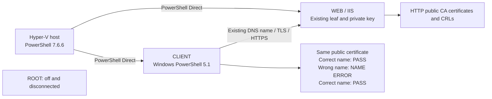

# Day 17 — Diagnose and correct a certificate hostname error

Prepared October 2, 2026 • Revision 1 • Status: prepared; live execution pending.

## Today’s outcome

Use the HTTPS endpoint completed on Days 15–16, reproduce a certificate name-validation failure, explain the evidence, and validate the correction. Days 15 and 16 finished on time. Their recorded closeout is commit `9bc97c3` on `feat/day15-16-web-tls`; Day 14 is `62344d6`.

Allow **60–90 minutes**, including explanations and saving results. If one unexpected problem consumes 15 minutes, save the exact error and resume from that point. ROOT stays off. The unresolved clock-synchronization issue and missing Day 14 pre-change legacy-CA hash remain recorded limitations.

**Experiment:** validate the same public leaf certificate against the correct DNS name, then an intentionally wrong name, then the correct name again. This is a certificate-file SSL-policy test on CLIENT. Separate live TLS/HTTPS checks before and after prove the actual endpoint still works. The experiment changes the requested identity; it requires no certificate reissuance, trust-store edits, DNS changes, or IIS changes.



## Working rules for this and later days

- Paste **one block at a time** into **elevated, 64-bit PowerShell 7.6.6 on the Hyper-V host**. Keep that terminal open. A block containing `Invoke-Command -Session ...` runs its braces inside the named guest.
- Reuse the Day 14 connection pattern: `Get-Credential`, then `New-PSSession -VMName ... -Credential ...`. Each credential prompt gets its own block. Finish entering credentials before pasting the next block.
- No `y`/`yes` prompts or `Read-Host` questions are embedded in the workflow. If an unexpected confirmation appears, stop and retain the command and prompt text.
- Discover paths separately, then copy or write them down before the following step. Context files supply VM names, addresses, and the certificate thumbprint.
- A red error outside the intentional negative test means stop at that block. Do not paste later blocks.
- When a correction is needed, replace the affected block in this saved runbook and update the correction log at the end. This file is the canonical Day 17 sequence.

## 0. Find yesterday’s evidence — HOST

### 0A. Run discovery by itself

```powershell
$ErrorActionPreference = 'Stop'
$EvidenceRoot = Join-Path $env:LOCALAPPDATA 'CloudSecurityLab'
$Day16Folders = @(Get-ChildItem -LiteralPath $EvidenceRoot -Directory -Filter 'day15-16-*' |
    Where-Object { Test-Path -LiteralPath (Join-Path $_.FullName 'resume.xml') })
if ($Day16Folders.Count -eq 0) { throw 'No Day 15-16 resume.xml found in this Windows profile.' }
$Day16Folders | Select-Object Name, FullName | Format-List
```

**Copy or write down the full folder path shown above.** It should contain yesterday’s `resume.xml` and `web.cer`. Keep it in your private lab notes. The preparation review found one matching folder, dated October 1.

### 0B. Load the discovered folder

```powershell
if ($Day16Folders.Count -ne 1) { throw 'Several sessions exist. Select the completed session with the tutor before continuing.' }
$Day16Evidence = $Day16Folders[0].FullName
$Day16State = Import-Clixml -LiteralPath (Join-Path $Day16Evidence 'resume.xml')
if ([int]$Day16State.LastCompletedPhase -ne 7) { throw 'This is not the completed Phase 7 record.' }
$Day14Evidence = $Day16State.Day14Evidence
$Ctx = Import-Clixml -LiteralPath (Join-Path $Day14Evidence 'context.xml')
if ($Ctx.HostName -ine $env:COMPUTERNAME) { throw 'Use the recorded Hyper-V host.' }
$RootVM = $Ctx.RootVM
$WebVM = $Ctx.WebVM
$ClientVM = $Ctx.ClientVM
$DcVM = $Ctx.DcVM
$IssuerVM = $Ctx.IssuerVM
$WebFqdn = $Day16State.WebFqdn
$WebIP = $Ctx.WebIP
$LeafThumb = $Day16State.LeafThumbprint
$PublicCert = Join-Path $Day16Evidence 'web.cer'
if (-not (Test-Path -LiteralPath $PublicCert -PathType Leaf)) { throw 'Saved public web.cer is missing.' }
$SavedLeaf = [System.Security.Cryptography.X509Certificates.X509Certificate2]::new($PublicCert)
try {
    if ($SavedLeaf.Thumbprint -ne $LeafThumb) { throw 'Saved certificate does not match the completion record.' }
    $SavedLeaf | Select-Object Subject, Issuer, NotBefore, NotAfter, Thumbprint
} finally { $SavedLeaf.Dispose() }
[pscustomobject]@{Host=$Ctx.HostName; WEB=$WebVM; CLIENT=$ClientVM; DNSName=$WebFqdn}
```

**Expected:** the completed record and saved leaf agree. `Import-Clixml` restores yesterday’s objects; it does not deploy anything. `Join-Path` builds a path without manually joining slashes.

## 1. Check the host and VM readiness — HOST

```powershell
if ($PSVersionTable.PSEdition -ne 'Core' -or $PSVersionTable.PSVersion.Major -ne 7) {
    throw 'Open PowerShell 7 on the Hyper-V host.'
}
if (-not [Environment]::Is64BitProcess) { throw 'Use the 64-bit terminal.' }
$Principal = [Security.Principal.WindowsPrincipal]::new([Security.Principal.WindowsIdentity]::GetCurrent())
if (-not $Principal.IsInRole([Security.Principal.WindowsBuiltInRole]::Administrator)) {
    throw 'Reopen PowerShell 7 as administrator, then repeat Section 0.'
}
$PSNativeCommandUseErrorActionPreference = $false
Import-Module Hyper-V -ErrorAction Stop
$PSVersionTable.PSVersion
Get-VM -Name $RootVM,$DcVM,$IssuerVM,$WebVM,$ClientVM | Select-Object Name, State
$SavedWebVM = Import-Clixml -LiteralPath (Join-Path $Day14Evidence ($WebVM + '-vm.xml'))
if ((Get-VM -Name $WebVM).Id -ne $SavedWebVM.Id) { throw 'WEB no longer matches its recorded VM ID.' }
if ((Get-VM -Name $RootVM).State -ne 'Off') { throw 'ROOT should be off; inspect before proceeding.' }
if (@(Get-VMNetworkAdapter -VMName $RootVM | Where-Object SwitchName).Count -ne 0) {
    throw 'ROOT has a connected network adapter; inspect before proceeding.'
}
foreach ($Name in @($DcVM,$WebVM,$ClientVM)) {
    if ((Get-VM -Name $Name).State -ne 'Running') { throw "Start the recorded $Name in Hyper-V Manager, wait for Windows to boot, then repeat this block." }
}
```

**Expected:** host 7.6.6; DC, WEB and CLIENT running; ROOT off/disconnected. ISSUER is listed for context; existing valid certificate and CRL files can be checked without opening a CA session. We only need WEB and CLIENT sessions today.

`$PSNativeCommandUseErrorActionPreference = $false` allows the intentional `certutil.exe` failure to be inspected. Each native result is checked explicitly. It does not change certificate validation or confirmation policy.

## 2. Connect using the Day 14 pattern — HOST

### 2A. WEB credentials — run this block alone

```powershell
$WebCred = Get-Credential -UserName "$WebVM\Administrator" -Message 'Existing WEB local Administrator password'
```

Finish the prompt. WEB is a workgroup machine; use its existing local administrator. If you used another local administrator, edit the username in the prompt. Never paste the password into chat or a code block.

### 2B. WEB session

```powershell
$WebSession = New-PSSession -VMName $WebVM -Credential $WebCred
Invoke-Command -Session $WebSession {
    [pscustomobject]@{Computer=$env:COMPUTERNAME; Version=$PSVersionTable.PSVersion.ToString(); Edition=$PSVersionTable.PSEdition}
}
```

### 2C. CLIENT credentials — run this block alone

```powershell
$ClientCred = Get-Credential -Message 'Existing CLIENT administrator used successfully on Day 14'
```

Use the same account that worked before. Qualify a local account as `COMPUTER\username` or a domain account as `DOMAIN\username`.

### 2D. CLIENT session

```powershell
$ClientSession = New-PSSession -VMName $ClientVM -Credential $ClientCred
Invoke-Command -Session $ClientSession {
    [pscustomobject]@{Computer=$env:COMPUTERNAME; Version=$PSVersionTable.PSVersion.ToString(); Edition=$PSVersionTable.PSEdition}
}
```

**Expected for both guests:** the intended computer, Desktop edition, Windows PowerShell 5.1. `New-PSSession` connects; `Invoke-Command` runs work through that connection. This is the same basic connection form used in Day 14 and documented by [Microsoft’s PowerShell Direct guide](https://learn.microsoft.com/en-us/windows-server/virtualization/hyper-v/powershell-direct).

### 2E. Verify the engines and clocks before testing

```powershell
foreach ($Session in @($WebSession,$ClientSession)) {
    $Engine = Invoke-Command -Session $Session {
        [pscustomobject]@{Computer=$env:COMPUTERNAME; Edition=$PSVersionTable.PSEdition;
            Major=$PSVersionTable.PSVersion.Major; Minor=$PSVersionTable.PSVersion.Minor;
            Is64Bit=[Environment]::Is64BitProcess; Utc=[datetime]::UtcNow.ToString('o')}
    }
    if ($Engine.Edition -ne 'Desktop' -or $Engine.Major -ne 5 -or $Engine.Minor -ne 1 -or -not $Engine.Is64Bit) {
        throw 'Guest engine differs from the tested Windows PowerShell 5.1 command environment.'
    }
    $Skew = [math]::Abs(([datetime]::UtcNow - [datetime]::Parse($Engine.Utc).ToUniversalTime()).TotalSeconds)
    [pscustomobject]@{Computer=$Engine.Computer; UTC=$Engine.Utc; SkewSeconds=[math]::Round($Skew,1)}
    if ($Skew -gt 60) { throw 'Guest clock differs by more than 60 seconds. Diagnose time before certificates.' }
}
[datetime]::UtcNow
```

Compare the final host UTC with a reliable clock. Small guest/host differences establish agreement, not a healthy synchronization source. If the host clock itself is wrong, pause here.

**If a session fails:** keep the exact error and stop at that connection. Check the VM is fully booted, the host terminal is elevated, and the account can sign into that VM. Do not replace the connection method, enable network WinRM, or rerun provisioning to fix an uninvestigated login error.

## 3. Create today’s private evidence and inspect WEB

### 3A. HOST — new Day 17 session only

If resuming an existing Day 17 session, use the Resume section instead of creating another folder.

```powershell
$Stamp = Get-Date -Format yyyyMMdd-HHmmss
$Evidence = Join-Path $EvidenceRoot "day17-$Stamp"
$GuestDay17 = "C:\LabPKI\day17-$Stamp"
$ClientCertPath = Join-Path $GuestDay17 'baseline-web.cer'
New-Item -ItemType Directory -Path $Evidence | Out-Null
$State17 = [ordered]@{HostName=$env:COMPUTERNAME; Day16Evidence=$Day16Evidence;
    Evidence=$Evidence; GuestDay17=$GuestDay17; ClientCertPath=$ClientCertPath;
    BaselinePassed=$false; CorrectNamePassed=$false; WrongNameRejected=$false;
    CorrectedNamePassed=$false; FinalBaselinePassed=$false; WrongName='wrong-name.invalid'}
$State17 | Export-Clixml -LiteralPath (Join-Path $Evidence 'resume.xml')
$Evidence
```

**Copy or write down the full Day 17 evidence path now.** It is needed if you close the terminal. The folder stays outside Git. Credentials are not saved in the context file.

### 3B. WEB — inspect the existing certificate and bindings

```powershell
Invoke-Command -Session $WebSession {
    $ErrorActionPreference = 'Stop'
    Import-Module WebAdministration
    $Cert = Get-Item "Cert:\LocalMachine\My\$using:LeafThumb"
    if (-not $Cert.HasPrivateKey) { throw 'The expected WEB certificate has no private key.' }
    if ((Get-Date) -lt $Cert.NotBefore -or (Get-Date) -gt $Cert.NotAfter) { throw 'Certificate is outside its validity period.' }
    $Cert | Select-Object Subject, DnsNameList, Issuer, NotAfter, Thumbprint, HasPrivateKey
    Get-Website -Name 'Default Web Site' | Select-Object Name, State
    Get-WebBinding -Name 'Default Web Site' |
        Select-Object protocol, bindingInformation, sslFlags, certificateHash, certificateStoreName
} | Tee-Object -FilePath (Join-Path $Evidence 'web-before.txt')
```

**Expected:** yesterday’s leaf, its private key, the existing HTTPS hostname binding, and the HTTP binding. SAN is the list of identities the certificate covers. The IIS binding selects which certificate the service presents.

### 3C. HOST → CLIENT — transfer only the saved public certificate

```powershell
Invoke-Command -Session $ClientSession {
    $ErrorActionPreference = 'Stop'
    if (-not (Test-Path -LiteralPath $using:GuestDay17)) {
        New-Item -ItemType Directory -Path $using:GuestDay17 | Out-Null
    }
}
Copy-Item -ToSession $ClientSession -LiteralPath $PublicCert -Destination $ClientCertPath
Invoke-Command -Session $ClientSession {
    $ErrorActionPreference = 'Stop'
    $Cert = New-Object System.Security.Cryptography.X509Certificates.X509Certificate2($using:ClientCertPath)
    try {
        if ($Cert.Thumbprint -ne $using:LeafThumb) { throw 'CLIENT file differs from the recorded leaf.' }
        $Cert | Select-Object Subject, DnsNameList, Thumbprint
    } finally { $Cert.Dispose() }
}
```

`Copy-Item -ToSession` reuses PowerShell Direct. This transfers the public `.cer`; the private key remains on WEB.

## 4. Verify the actual endpoint — CLIENT

### 4A. HOST — keep the successful Day 16 validation in one reusable block

This defines the commands; the next block runs them. It retains yesterday’s DNS, TCP, chain, strict TLS, leaf-thumbprint and page checks. The timeout and resource cleanup are small reliability additions. `$using:` passes a host variable into CLIENT.

```powershell
$ClientBaseline = {
    $ErrorActionPreference = 'Stop'
    $Dns = Resolve-DnsName $using:WebFqdn -Type A
    if ($using:WebIP -notin @($Dns.IPAddress)) { throw 'DNS does not point to the recorded WEB address.' }
    if (-not (Test-NetConnection -ComputerName $using:WebFqdn -Port 443 -InformationLevel Quiet)) {
        throw 'TCP 443 failed. Diagnose reachability before TLS.'
    }
    certutil.exe -verify -urlfetch -t 10000 $using:ClientCertPath
    if ($LASTEXITCODE -ne 0) { throw 'Leaf chain/revocation verification failed.' }
    $Tcp = New-Object System.Net.Sockets.TcpClient
    $Tls = $null
    $Presented = $null
    try {
        $Tcp.ReceiveTimeout = 15000
        $Tcp.SendTimeout = 15000
        $Tcp.Connect($using:WebFqdn,443)
        $Tls = New-Object System.Net.Security.SslStream($Tcp.GetStream(),$false)
        $Tls.ReadTimeout = 15000
        $Tls.WriteTimeout = 15000
        $Tls.AuthenticateAsClient($using:WebFqdn,$null,[System.Security.Authentication.SslProtocols]::Tls12,$true)
        $Presented = New-Object System.Security.Cryptography.X509Certificates.X509Certificate2($Tls.RemoteCertificate)
        if ($Presented.Thumbprint -ne $using:LeafThumb) { throw 'The endpoint presents a different leaf.' }
        if (-not $Tls.IsAuthenticated -or -not $Tls.IsEncrypted) { throw 'TLS authentication/encryption check failed.' }
        [pscustomobject]@{TLS=$Tls.SslProtocol; Authenticated=$Tls.IsAuthenticated; ExpectedLeafPresented=$true}
    } finally {
        if ($Presented) { $Presented.Dispose() }
        if ($Tls) { $Tls.Dispose() }
        $Tcp.Dispose()
    }
    $PreviousProtocol = [Net.ServicePointManager]::SecurityProtocol
    try {
        [Net.ServicePointManager]::SecurityProtocol = [Net.SecurityProtocolType]::Tls12
        $Page = Invoke-WebRequest -UseBasicParsing -Uri "https://$using:WebFqdn/day16.txt" -TimeoutSec 30
        if ($Page.StatusCode -ne 200 -or $Page.Content.Trim() -ne 'Day16 HTTPS baseline OK') {
            throw 'The expected HTTPS marker was not returned.'
        }
        [pscustomobject]@{HTTPSStatus=$Page.StatusCode; MarkerMatched=$true}
        $Public = Invoke-WebRequest -UseBasicParsing -Uri "http://$using:WebFqdn/pki/issuer.crl" -TimeoutSec 30
        if ($Public.StatusCode -ne 200) { throw 'HTTP issuer CRL retrieval failed.' }
        [pscustomobject]@{HTTP_CRL_Status=$Public.StatusCode}
    } finally { [Net.ServicePointManager]::SecurityProtocol = $PreviousProtocol }
}
```

### 4B. Run and record the baseline

```powershell
$State17.BaselinePassed = $false
$State17.FinalBaselinePassed = $false
$State17 | Export-Clixml -LiteralPath (Join-Path $Evidence 'resume.xml')
Invoke-Command -Session $ClientSession -ScriptBlock $ClientBaseline |
    Tee-Object -FilePath (Join-Path $Evidence 'baseline-before.txt')
$State17.BaselinePassed = $true
$State17 | Export-Clixml -LiteralPath (Join-Path $Evidence 'resume.xml')
```

**Expected:** successful chain/revocation check; authenticated TLS 1.2 with the exact leaf; HTTPS 200 and marker match; HTTP CRL 200. Any unexpected failure must be diagnosed before the negative test. Valid cached CRLs can satisfy revocation checks; HTTP 200 separately proves retrieval, not fresh revocation evaluation of that downloaded file. [Microsoft’s SslStream API](https://learn.microsoft.com/en-us/dotnet/api/system.net.security.sslstream.authenticateasclient?view=netframework-4.8.1) documents the target-name and revocation parameters.

## 5. Reproduce and diagnose the hostname error — CLIENT

### 5A. Correct name: establish that SSL-policy validation works

```powershell
$State17.CorrectNamePassed = $false
$State17 | Export-Clixml -LiteralPath (Join-Path $Evidence 'resume.xml')
Invoke-Command -Session $ClientSession {
    $ErrorActionPreference = 'Stop'
    certutil.exe -verify -urlfetch -t 10000 -sslpolicy $using:WebFqdn $using:ClientCertPath
    if ($LASTEXITCODE -ne 0) { throw 'Correct-name SSL policy failed. Stop before the negative test.' }
} | Tee-Object -FilePath (Join-Path $Evidence 'name-correct-before.txt')
$State17.CorrectNamePassed = $true
$State17 | Export-Clixml -LiteralPath (Join-Path $Evidence 'resume.xml')
```

**New command option:** `-sslpolicy NAME` asks Windows to validate the certificate for that server identity. It does not connect to a website named NAME. `-urlfetch` allows retrieval of certificate-chain and revocation material. [Microsoft’s certutil reference](https://learn.microsoft.com/en-us/windows-server/administration/windows-commands/certutil#-verify) documents these options.

### 5B. Wrong name: expect a specific name error

```powershell
$WrongName = $State17.WrongName
$State17.WrongNameRejected = $false
$State17.CorrectedNamePassed = $false
$State17.FinalBaselinePassed = $false
$State17 | Export-Clixml -LiteralPath (Join-Path $Evidence 'resume.xml')
$NameFailure = Invoke-Command -Session $ClientSession {
    $ErrorActionPreference = 'Stop'
    $Text = @(certutil.exe -verify -urlfetch -t 10000 -sslpolicy $using:WrongName $using:ClientCertPath)
    $ExitCode = $LASTEXITCODE
    [pscustomobject]@{ExitCode=$ExitCode; Output=($Text -join [Environment]::NewLine)}
}
$NameFailure.Output | Tee-Object -FilePath (Join-Path $Evidence 'name-wrong.txt')
$ExitHex = '0x{0:X8}' -f [int]$NameFailure.ExitCode
"Exit code: $($NameFailure.ExitCode) / $ExitHex" |
    Tee-Object -FilePath (Join-Path $Evidence 'name-wrong-exit-code.txt')
if ($ExitHex -ne '0x800B010F' -or $NameFailure.Output -notmatch '(?i)800b010f|CERT_E_CN_NO_MATCH') {
    throw 'The specific hostname-mismatch failure was not confirmed. Retain the output; do not count another error as success.'
}
$State17.WrongNameRejected = $true
$State17 | Export-Clixml -LiteralPath (Join-Path $Evidence 'resume.xml')
```

**Expected:** nonzero exit and `0x800B010F` / `CERT_E_CN_NO_MATCH`. The expected failure is captured as evidence. A trust, expiry, network, or unsupported-option error alone does not satisfy this test.

### 5C. Inspect the public certificate and explain the cause

```powershell
Invoke-Command -Session $ClientSession {
    $ErrorActionPreference = 'Stop'
    certutil.exe -dump $using:ClientCertPath
    if ($LASTEXITCODE -ne 0) { throw 'Certificate inspection failed.' }
} | Tee-Object -FilePath (Join-Path $Evidence 'certificate-inspection.txt')
[pscustomobject]@{ExpectedIdentity=$WebFqdn; IntentionallyWrongIdentity=$WrongName; SameLeafThumbprint=$LeafThumb}
```

Find **Subject Alternative Name** and **Server Authentication** in the output. Explain these three points in your notes:

1. The trusted chain and the hostname are separate checks. The same certificate can pass one and fail the other.
2. The requested wrong name is absent from the certificate’s SAN. Changing a DNS record alone would not add it to the certificate.
3. Here, the correction is to use the existing certified name. A genuinely required new service identity would need planned certificate issuance and binding work.

## 6. Correct the input and repeat the actual endpoint test

### 6A. CLIENT — correct the name

```powershell
$State17.CorrectedNamePassed = $false
$State17.FinalBaselinePassed = $false
$State17 | Export-Clixml -LiteralPath (Join-Path $Evidence 'resume.xml')
Invoke-Command -Session $ClientSession {
    $ErrorActionPreference = 'Stop'
    certutil.exe -verify -urlfetch -t 10000 -sslpolicy $using:WebFqdn $using:ClientCertPath
    if ($LASTEXITCODE -ne 0) { throw 'Corrected-name validation failed.' }
} | Tee-Object -FilePath (Join-Path $Evidence 'name-correct-after.txt')
$State17.CorrectedNamePassed = $true
$State17 | Export-Clixml -LiteralPath (Join-Path $Evidence 'resume.xml')
```

### 6B. CLIENT — reuse the identical live validation block

```powershell
$State17.FinalBaselinePassed = $false
$State17 | Export-Clixml -LiteralPath (Join-Path $Evidence 'resume.xml')
Invoke-Command -Session $ClientSession -ScriptBlock $ClientBaseline |
    Tee-Object -FilePath (Join-Path $Evidence 'baseline-after.txt')
$State17.FinalBaselinePassed = $true
$State17 | Export-Clixml -LiteralPath (Join-Path $Evidence 'resume.xml')
```

**Expected:** corrected name passes; actual TLS/HTTPS and public HTTP CRL checks pass again. The before/after leaf thumbprint stays the same. Today’s evidence demonstrates a controlled hostname-policy failure and successful live endpoint validation; it does not demonstrate a revoked-leaf test or a CA recovery.

## 7. Save results and disconnect — HOST

### 7A. Create results from completed checks

```powershell
if (-not ($State17.BaselinePassed -and $State17.CorrectNamePassed -and
    $State17.WrongNameRejected -and $State17.CorrectedNamePassed -and $State17.FinalBaselinePassed)) {
    throw 'Required checks are incomplete. Keep the resume record and record PARTIAL in your notes.'
}
if ((Get-VM -Name $RootVM).State -ne 'Off' -or
    @(Get-VMNetworkAdapter -VMName $RootVM | Where-Object SwitchName).Count -ne 0) {
    throw 'ROOT isolation check failed at closeout.'
}
$ResultsPath = Join-Path $Evidence 'day17-results.md'
$Results = @(
    '# Day 17 — Certificate troubleshooting results'
    ''
    ('Date: ' + (Get-Date -Format yyyy-MM-dd))
    ''
    'Status: COMPLETE'
    'Days 15 and 16: completed on time, reported October 2, 2026.'
    'Existing endpoint baseline before test: PASS'
    'Correct-name certificate SSL policy: PASS'
    'Wrong-name SSL policy: rejected with CERT_E_CN_NO_MATCH / 0x800B010F'
    'Cause: requested identity was absent from the certificate SAN.'
    'Correction: use the existing certified DNS identity.'
    'Corrected-name SSL policy: PASS'
    'Live TLS exact-leaf / HTTPS marker / public HTTP CRL checks after test: PASS'
    'ROOT off and disconnected at closeout: PASS'
    'Infrastructure configuration changes for the experiment: NONE'
    'Scope: certificate-file hostname-policy experiment plus live endpoint validation.'
    'Revoked-leaf behavior and CA recovery: NOT TESTED'
    'Clock synchronization health: unresolved; manual accuracy remains a separate check.'
    'Day 14 legacy-CA pre-change hash evidence gap: retained.'
    'Private evidence retained outside Git; no private keys or raw logs included here.'
    'Commit/push: see Git history for final status.'
)
$Results | Set-Content -LiteralPath $ResultsPath -Encoding utf8
Get-Content -LiteralPath $ResultsPath
$ResultsPath
```

**Copy or write down this results-file path** for the Git step. Review the statements before copying them to the repository. If you made extra troubleshooting changes, edit the infrastructure-change line to match reality.

### 7B. Disconnect only today’s sessions

```powershell
Remove-PSSession -Session $WebSession,$ClientSession
Remove-Variable WebCred,ClientCred -ErrorAction SilentlyContinue
$Evidence
```

Keep the terminal open for Git. Keep the working certificate, template, IIS endpoint and public CA/CRL files. If the terminal closes, the private resume file retains progress; credentials must be entered again.

## 8. Save the actual runbook and results in Git — HOST

### 8A. Discover deliverables separately

```powershell
$Pack = Join-Path $env:USERPROFILE 'Documents\Codex\2026-10-02\lets-get-started-with-day-17\outputs'
Get-ChildItem -LiteralPath $Pack -File -Filter 'DAY-17-RUNBOOK.md' | Select-Object FullName | Format-List
Get-Item -LiteralPath $ResultsPath | Select-Object FullName | Format-List
Get-Item -LiteralPath 'C:\git\azure-secure-hub-spoke-lab' | Select-Object FullName | Format-List
```

**Copy or write down these three paths before continuing.** Both source files must exist. The script uses this chat’s actual local output folder. If you saved a newer corrected runbook elsewhere, discover that file first and set `$Pack` to its containing folder. Only the runbook and actual results are staged; the private handoff and raw evidence stay outside the repository.

### 8B. Check current repository state

```powershell
Set-Location -LiteralPath 'C:\git\azure-secure-hub-spoke-lab'
git status --short --branch
if ($LASTEXITCODE -ne 0) { throw 'Git status failed.' }
git log -2 --oneline
if ($LASTEXITCODE -ne 0) { throw 'Git log failed.' }
```

Expected initial branch: `feat/day15-16-web-tls`, with `9bc97c3` present. If there are unrelated changes, retain them and resolve the starting point with the tutor before copying or committing files.

### 8C. Create or resume the Day 17 branch and copy both existing files

```powershell
$Branch = git branch --show-current
if ($LASTEXITCODE -ne 0) { throw 'Cannot read branch.' }
if ($Branch -ne 'feat/day17-certificate-troubleshooting') {
    if ($Branch -ne 'feat/day15-16-web-tls') { throw 'Unexpected starting branch; inspect before switching.' }
    $Pending = @(git status --porcelain)
    if ($LASTEXITCODE -ne 0 -or $Pending.Count -ne 0) { throw 'Review existing changes before creating the Day 17 branch.' }
    git switch -c feat/day17-certificate-troubleshooting
    if ($LASTEXITCODE -ne 0) { throw 'Branch creation failed; if it already exists, inspect it before switching.' }
}
Copy-Item -LiteralPath (Join-Path $Pack 'DAY-17-RUNBOOK.md') -Destination 'docs\day17-runbook.md'
Copy-Item -LiteralPath $ResultsPath -Destination 'docs\day17-results.md'
git diff -- docs/day17-runbook.md docs/day17-results.md
git status --short --branch
```

### 8D. Stage and review exactly two files

```powershell
$AlreadyStaged = @(git diff --cached --name-only)
if ($LASTEXITCODE -ne 0) { throw 'Cannot inspect staging.' }
if (@($AlreadyStaged | Where-Object { $_ -notin @('docs/day17-runbook.md','docs/day17-results.md') }).Count) {
    throw 'Other files are staged. Review them before continuing.'
}
git add -- docs/day17-runbook.md docs/day17-results.md
if ($LASTEXITCODE -ne 0) { throw 'Staging failed.' }
git diff --cached --name-only
git --no-pager diff --cached -- docs/day17-results.md
git diff --cached --check
if ($LASTEXITCODE -ne 0) { throw 'Resolve formatting errors before committing.' }
```

Expected staged files: exactly `docs/day17-runbook.md` and `docs/day17-results.md`. Inspect the saved runbook too, especially any corrections made during execution. `git diff --cached --check` should print nothing. `git add` selects files; `git diff --cached` shows the snapshot about to be committed.

### 8E. Commit, push, and verify

```powershell
git commit -m 'docs: record certificate hostname troubleshooting and recovery'
if ($LASTEXITCODE -ne 0) { throw 'Commit failed; inspect the message.' }
git push -u origin feat/day17-certificate-troubleshooting
if ($LASTEXITCODE -ne 0) { throw 'Push failed; preserve the local commit and retry only the push after diagnosis.' }
git status --short --branch
git log -2 --oneline
```

Expected: Day 17 branch tracks its remote and has no pending files. If the commit already exists after an interruption, inspect the log and run only the unfinished push/verification commands.

## Resume after closing the terminal

1. Run Section 0 to restore yesterday’s context, then Sections 1–2 to reconnect. Do not recreate certificates or repeat Day 15–16 issuance.
2. Discover today’s folder using this separate block:

```powershell
$Day17Folders = @(Get-ChildItem -LiteralPath $EvidenceRoot -Directory -Filter 'day17-*' |
    Where-Object { Test-Path -LiteralPath (Join-Path $_.FullName 'resume.xml') })
$Day17Folders | Select-Object Name, FullName | Format-List
```

**Copy or write down the existing Day 17 folder path** and compare it with your notes. Then load it:

```powershell
if ($Day17Folders.Count -ne 1) { throw 'Select the intended saved Day 17 session with the tutor; do not guess the latest folder.' }
$Evidence = $Day17Folders[0].FullName
$State17 = Import-Clixml -LiteralPath (Join-Path $Evidence 'resume.xml')
if ($State17.HostName -ine $env:COMPUTERNAME -or $State17.Day16Evidence -ine $Day16Evidence) {
    throw 'Resume record belongs to a different host or baseline.'
}
$GuestDay17 = $State17.GuestDay17
$ClientCertPath = $State17.ClientCertPath
$WrongName = $State17.WrongName
$ResultsPath = Join-Path $Evidence 'day17-results.md'
[pscustomobject]$State17 | Format-List
```

3. Skip Section 3A. Section 3C can safely restore the same public certificate copy. Run Section 4A to recreate the reusable validation block, then rerun 4B because an interrupted session needs a fresh baseline check. Continue at the first unfinished test. Repeating the name checks changes no infrastructure.
4. If only Git remains, no VM reconnection is needed: run Section 0, the Day 17 discovery/load blocks above, then Section 8. Read the existing results and Git history before repeating any completed commit.

## Diagnosis guide

| First failing check | What it establishes | Next evidence to inspect |
|---|---|---|
| PowerShell Direct connection | Host/guest access failed before lab commands | VM boot state, elevation, guest username/password, exact connection error |
| DNS A record | Expected service name does not resolve to recorded WEB | CLIENT DNS output and saved WEB address |
| TCP 443 | The HTTPS port was not reached | Existing IIS binding/site state and firewall rule |
| Certificate chain/revocation | Trust, dates, or revocation data failed | Exact certutil error, issuer/root chain and CRL validity/reachability |
| Correct-name SSL policy | Name or certificate policy does not match the baseline | SAN, requested name, EKU, full error |
| Wrong-name test gives another error | Controlled name failure was not demonstrated | Compare with 5A; diagnose the unexpected dependency |
| Strict TLS leaf check | Endpoint identity or certificate differs | Actual leaf versus saved thumbprint, binding and SNI |
| HTTPS marker | The application response differs | HTTP status and marker content after TLS passes |

## Preparation validation and correction log

The preparation review read the actual Day 14 runbook, Day 15–16 runbook, saved context/resume records, public leaf, successful CLIENT validation log, results file, and Git commit history. All 27 PowerShell blocks passed parsing in local PowerShell 7.6.6 and Windows PowerShell 5.1. Both engines expose the required session/copy parameters; credential prompts are isolated; no block uses Read-Host. Local certutil help confirms the SSL-policy option, and its error lookup confirms the intended name-mismatch code. VM logins and Day 17 tests remain for the guided lab session; parsing does not establish live success.

| Revision | Change | Reason |
|---|---|---|
| 1 — October 2, 2026 | Reuse Day 14 direct sessions; isolate credential prompts; discover paths first; retain Day 16 baseline checks; add a controlled name-policy comparison | User’s reliability requirements and Day 17 troubleshooting objective |

When changing this file after an error, update the original block, add a concise revision row, recheck the changed syntax, and record whether the replacement actually passed on the target machine.
